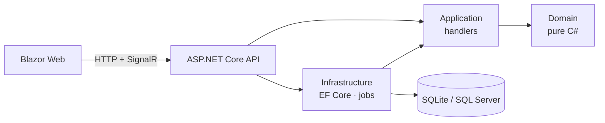

# ParentPortal

[](https://github.com/Roshankm/ParentPortal/actions/workflows/ci.yml)


A **multi-tenant school–parent communication platform** built with .NET 10, Blazor, ASP.NET Core Minimal APIs, EF Core and SignalR.

Schools publish announcements to the whole school or a single class. Parents receive them **in real time** and acknowledge them, so teachers can see who has read each one. Urgent announcements that are still open after 24 hours trigger an automatic reminder.

> I built this to show how I design production .NET systems: clean boundaries, tenant isolation that is enforced and tested, and a codebase another developer can pick up quickly.

---

## Highlights

| Area | What's implemented |
|---|---|
| **Architecture** | Clean Architecture with a dependency-free domain model, use-case handlers and [ADRs](docs/adr) |
| **Multi-tenancy** | Shared schema with EF Core global query filters on `SchoolId`, defence-in-depth checks, and tests that attempt cross-tenant access |
| **Auth** | Microsoft Entra ID (JWT bearer) when configured, with a demo header scheme for zero-setup runs ([ADR 5](docs/adr/0005-entra-id-with-demo-fallback.md)) |
| **Real time** | SignalR hub with per-school groups. Parents see new announcements instantly |
| **Background work** | `BackgroundService` + `PeriodicTimer` reminder job for unacknowledged urgent announcements |
| **API design** | Minimal APIs, OpenAPI, RFC 9457 Problem Details, `Result` pattern instead of exceptions for business rules |
| **Front end** | Blazor Web App (Interactive Server), typed API client, role-aware UI |
| **Data** | EF Core 10, SQLite by default, SQL Server via configuration (`docker-compose.yml` included) |
| **Quality** | xUnit domain and handler tests with in-memory fakes, `WebApplicationFactory` integration tests, warnings as errors, central package management, CI on every PR, Dependabot |

## Architecture



More detail, including the request sequence and tenancy rules, is in [docs/architecture.md](docs/architecture.md).

```
src/
  ParentPortal.Domain          Entities, business rules, Result/Error - no dependencies
  ParentPortal.Contracts       DTOs shared by Api and Web
  ParentPortal.Application     Use-case handlers + abstractions (repositories, clock, notifications)
  ParentPortal.Infrastructure  EF Core, tenant query filters, seeding, reminder job, email
  ParentPortal.Api             Minimal API endpoints, auth, SignalR hub
  ParentPortal.Web             Blazor UI
tests/
  ParentPortal.UnitTests               Domain + handler tests
  ParentPortal.Api.IntegrationTests    Full HTTP pipeline against a real SQLite database
docs/
  architecture.md, adr/
```

## Run it locally

Prerequisite: [.NET 10 SDK](https://dotnet.microsoft.com/download). No database server or Azure account is needed.

```bash
git clone https://github.com/Roshankm/ParentPortal.git
cd ParentPortal

# terminal 1 - API on http://localhost:5180 (creates and seeds parentportal.db)
dotnet run --project src/ParentPortal.Api

# terminal 2 - Blazor UI on http://localhost:5078
dotnet run --project src/ParentPortal.Web
```

Then open http://localhost:5078 and pick a demo user.

**Try this:** open two browser windows. Sign in as *David Thomas (Teacher)* in one and *Fatima Khan (Parent)* in the other. Publish an announcement and watch it appear for the parent immediately. Then switch to *Priya Nair* from **Oakridge Academy** and confirm she sees none of Greenfield's data.

The API can also be explored with `src/ParentPortal.Api/ParentPortal.Api.http` or the OpenAPI document at `/openapi/v1.json`.

### Tests

```bash
dotnet test
```

### SQL Server instead of SQLite

```bash
docker compose up -d
dotnet run --project src/ParentPortal.Api -- --Database:Provider=SqlServer \
  "--ConnectionStrings:ParentPortal=Server=localhost,1433;Database=ParentPortal;User Id=sa;Password=Your_strong_password123;TrustServerCertificate=True"
```

### Microsoft Entra ID

Set `AzureAd:TenantId`, `AzureAd:ClientId` and `AzureAd:Audience` in `src/ParentPortal.Api/appsettings.json` (or user secrets). The demo scheme switches off automatically. See [ADR 5](docs/adr/0005-entra-id-with-demo-fallback.md).

## API

| Method | Route | Who |
|---|---|---|
| `GET` | `/api/announcements?classroomId=&page=&pageSize=` | Everyone (parents see published only) |
| `POST` | `/api/announcements` | Teacher, SchoolAdmin |
| `POST` | `/api/announcements/{id}/publish` | Teacher, SchoolAdmin |
| `POST` | `/api/announcements/{id}/acknowledge` | Parent |
| `GET` | `/api/classrooms` | Everyone |
| `POST` | `/api/classrooms` | SchoolAdmin |
| `GET` | `/health` | Public |
| `WS` | `/hubs/notifications` | Authenticated, joined to their school's group |

## Roadmap

- [ ] EF Core migrations (replace `EnsureCreated`)
- [ ] OpenID Connect sign-in in the Blazor app
- [ ] Interactive Auto render mode with a WebAssembly client project
- [ ] .NET Aspire AppHost and OpenTelemetry dashboards
- [ ] bUnit component tests and Playwright end-to-end tests
- [ ] Deploy to Azure Container Apps from GitHub Actions using OIDC federated credentials
- [ ] AI: "Ask the school" Q&A over announcements with `Microsoft.Extensions.AI`
- [ ] Parent ↔ teacher messaging

## About me

I'm Roshan, a Senior Software Engineer and Blazor team lead in the UAE, working with C#, .NET, Blazor, ASP.NET Core, SQL Server and Azure / Entra ID.

## License

[MIT](LICENSE)
