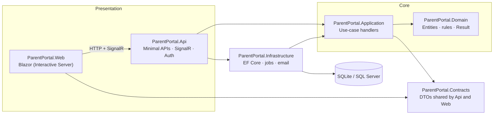
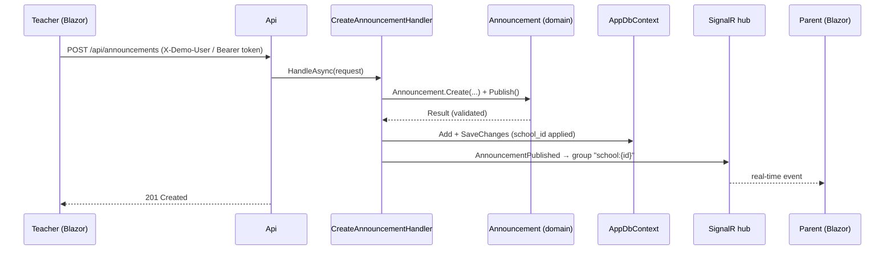

# Architecture

ParentPortal follows **Clean Architecture**: dependencies point inwards, and the domain has no
framework or package references at all.

## Rules

| Layer | May reference | Never references |
|---|---|---|
| Domain | nothing | EF Core, ASP.NET Core, any package |
| Application | Domain, Contracts | EF Core, HTTP, SignalR |
| Infrastructure | Application | Api, Web |
| Api | Application, Infrastructure | Web |
| Web | Contracts | Domain, Application, Infrastructure |

## Request flow: a teacher publishes an announcement

## Multi-tenancy

* Every tenant-owned entity implements `ITenantOwned` (`SchoolId`).
* `AppDbContext` applies a **global query filter** using the current user's `school_id` claim,
  so a query can never return another school's rows - even if a handler forgets to filter.
* Handlers also check `SchoolId` explicitly (defence in depth); the integration tests prove isolation.
* SignalR connections join a per-school group, so real-time events never cross tenants.
* The reminder job runs across tenants and therefore calls `IgnoreQueryFilters()` deliberately.
